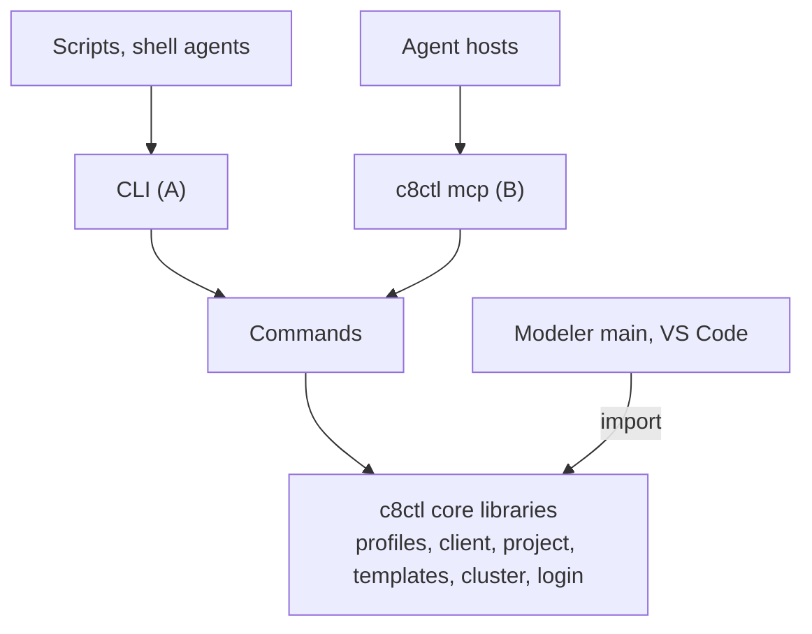

# Embedding c8ctl

> __Preliminary spec.__ Captures the goal, the options and a recommendation to decide on; not an implementation plan.

## Goal

`c8ctl` becomes the core of our local development flow. Essential capabilities - local cluster download + start (exists), hub login (not built yet), deploy, run, project resolution, element templates - are __implemented once, in `c8ctl`__. Desktop Modeler, VS Code, AI agents and scripts __build on them instead of rebuilding them__, and share one login, one profile store and one local cluster.

This sketch derives what embedders need, compares the ways to embed `c8ctl` against these needs, and recommends a direction.

## Needs

Every option below is measured against these. Each is rooted in an existing consumer or in the goal.

| #  | Need                                                                                     | Rooted in                                                                                                                                                                                             |
| -- | ---------------------------------------------------------------------------------------- | ----------------------------------------------------------------------------------------------------------------------------------------------------------------------------------------------------- |
| N1 | __One implementation__ of cluster access, project resolution, templates, local cluster   | Modeler duplicates them today, and some already diverge (see [Implemented twice](#implemented-twice))                                                                                                 |
| N2 | __One shared state__ - profiles, login, local cluster - visible to every tool, changes observable | Goal. A profile added in the terminal must show up in Modeler's connection picker                                                                                                           |
| N3 | __Actionable errors__ - stable codes, not sentences                                      | Modeler attaches connection errors to form fields (see [Errors](#errors))                                                                                                                             |
| N4 | __Long-running operations__ with progress, cancellation and user interaction             | `cluster start` downloads and boots c8run for minutes; hub login needs a browser step                                                                                                                 |
| N5 | __Bounded results__                                                                      | Agents break on unbounded output (see [Pagination](#pagination))                                                                                                                                      |
| N6 | __Independent release cadence__ - Modeler ships a pinned `c8ctl`, upgrades deliberately  | Modeler and `c8ctl` are separate products                                                                                                                                                             |
| N7 | __Agent access__ - shell-capable agents and agent hosts without a shell                   | Coding agents use the CLI today; desktop agent hosts speak MCP only                                                                                                                                   |

Explicitly __not__ a need (assumptions to confirm):

* __Unsaved editor state.__ Disk is the source of truth: embedders save before calling `c8ctl` (Modeler saves before deploy). Calls take paths, never content. No language-server-style overlays or `didChange`. Editing-time features (live linting, FEEL completion, properties panel) stay editor libraries.
* __`c8ctl` plugins inside Modeler.__ Attractive, but no consumer asks for it yet. Treated as a tie-breaker, not a requirement.

## Status quo

### Modeler and `c8ctl` today

Function-level comparison of Desktop Modeler (`develop`) and `c8ctl` (`main`), as of November 2026. This is the concrete surface the proposal builds from.

#### Shared today

Only __conventions__ are shared, no code. The two use different SDKs: Modeler uses `@camunda8/sdk` (gRPC + REST), `c8ctl` uses `@camunda8/orchestration-cluster-api` (REST only).

* __Connection schema__ - `c8ctl`'s `Connection` type mirrors Modeler's `connectionManagerPlugin.c8connections` entries. `c8ctl` reads them as read-only `modeler:` profiles.
* __`camunda.json`__ (and legacy `.process-application`) as the project marker.
* __`.camunda/element-templates/`__ as the project template folder.
* __`modeler:executionPlatformVersion`__ in the diagram, which both use to select version-specific lint rules and templates.

#### Implemented twice

| Function                  | Modeler                                                                                                                                                       | `c8ctl`                                                                                                                                  | Divergence to resolve                                             |
| ------------------------- | ------------------------------------------------------------------------------------------------------------------------------------------------------------- | ---------------------------------------------------------------------------------------------------------------------------------------- | ----------------------------------------------------------------- |
| Client + auth             | `zeebe-api/camunda-client-factory.js` - none / basic / OAuth, SaaS / self-managed, gRPC-first probing with REST fallback, custom CA (`--zeebe-ssl-certificate`, system certificates) | `core/client.ts` `createClient`, `resolveClusterConfig` - none / basic / OAuth, custom headers, env vars; REST only; CA via `NODE_EXTRA_CA_CERTS` | gRPC support; CA configuration                                     |
| Connection store          | `settings.json` `connectionManagerPlugin.c8connections`; secrets stored in plain text in settings                                                            | `profiles.json`; plus Modeler connections, read-only                                                                                     | Two stores, bridged in one direction only                          |
| Connection check          | `zeebe:checkConnection`, `zeebe:getGatewayVersion` - 11 classified error reasons                                                                              | `get topology` - error message text                                                                                                      | Error codes, see [Errors](#errors)                                 |
| Deploy file               | `zeebe:deploy`; normalizes REST results to the gRPC result shape                                                                                              | `deploy <file>`                                                                                                                          | Result shape                                                      |
| Deploy project            | `CamundaProjectsDeploymentPlugin` - every BPMN / DMN / form file in the project; the watcher skips only `node_modules` and `.git`                              | `deploy` - `findProjectRoot`, `collectResourcesForPaths`: deployable extensions, `.c8ignore`, deploy-always rules, extension allow-list per server version | __Same project, different deploy set__ - Modeler ignores `.c8ignore` today. _Note: Modeler will support `.c8ignore`._ |
| Start instance            | `zeebe:startInstance` - variables, business ID, start instructions, runtime terminate instructions (task testing)                                             | `create pi` - variables, business ID; `run` (deploy + start)                                                                             | `c8ctl` lacks start and runtime instructions                       |
| Instance inspection       | `zeebe:search{ProcessInstances,Variables,Incidents,Jobs,UserTasks}` (task testing)                                                                            | `search pi`, `search variable`, `search incident`, `search jobs`, `search user-task`                                                     | Pagination defaults                                               |
| Element instances         | `zeebe:searchElementInstances`, `zeebe:searchMessageSubscriptions` (task testing)                                                                             | Partly, via `search wait-state`                                                                                                          | `c8ctl` gap                                                       |
| Authorizations            | `zeebe:getAuthorizations`                                                                                                                                     | `search authorization`                                                                                                                   | -                                                                 |
| FEEL evaluation           | `zeebe:evaluateExpression` (cluster)                                                                                                                          | `feel evaluate` (cluster or local)                                                                                                       | -                                                                 |
| Cluster variables         | `zeebe:{search,get,create,update}ClusterVariable(s)`                                                                                                          | -                                                                                                                                        | `c8ctl` gap                                                       |
| Secret names              | `zeebe:listSecrets`                                                                                                                                           | - (`cluster secrets` manages local c8run secrets only)                                                                                   | `c8ctl` gap                                                       |
| Project index             | `file-context` - watcher and indexer, resolves links: `calledElement`, `calledDecision`, `formId`                                                             | `readCamundaProject`, `findProjectRoot` - no index, no links                                                                             | Modeler resolves links for editing; `c8ctl` does not need them yet |
| OOTB templates            | `template-updater` from `marketplace.cloud.camunda.io/api/v1/ootb-connectors`, plus custom URL sources                                                       | `element-template sync` from npm `@camunda/connectors-element-templates`                                                                 | __Same catalog, different sources__                               |
| Template resolution       | `ElementTemplatesProvider` - bundled, user, project templates                                                                                                 | `template-ref.ts` - project templates, then OOTB cache                                                                                   | User and custom-source templates                                  |
| BPMN linting              | `@camunda/linting` (renderer)                                                                                                                                 | `bpmn lint` - `bpmnlint:recommended` + `camunda-compat` for the diagram's version                                                        | __Different rule sets__ - the same diagram can lint differently    |

#### `c8ctl` capabilities Modeler does not use

| `c8ctl` capability                                                                        | Modeler today                                                    | Potential for Modeler                                                     |
| ----------------------------------------------------------------------------------------- | ---------------------------------------------------------------- | ------------------------------------------------------------------------- |
| Local cluster - `cluster install / start / stop / status / logs / list-remote / purge`     | Links to c8run download and docs                                 | __High__ - one-click local cluster with a matching connection              |
| Hub login (planned)                                                                       | Manual client credentials                                        | __High__ - sign in once; connections come with it                          |
| Instance operations - `cancel`, `suspend` / `resume`, `modify`, `migrate pi`              | -                                                                | Medium - clean up or migrate test instances after redeploying              |
| `search wait-state` - where an instance is waiting                                         | Assembled from several searches                                  | Medium - simpler task testing                                             |
| `watch` - redeploy on change                                                               | Manual deploy                                                    | Medium - deploy on save                                                   |
| c8run secrets and physical tenants                                                         | -                                                                | Medium - connector secrets for local runs                                 |
| `await pi`                                                                                 | Task testing polls                                               | Low                                                                       |
| Profiles from env vars / `.env`, custom headers                                            | -                                                                | Low - gateways that require extra headers                                 |
| Plugins                                                                                    | -                                                                | Unclear (see [Open questions](#open-questions))                           |
| Drive an instance - `complete job`, `fail job`, `complete user-task`, `resolve incident`, `publish` / `correlate message` | Task testing is read-only                                        | None - _Note: in Modeler, the user drives an instance forward._           |
| Identity management, `mcp-proxy`, `bpmn format`, `open operate / tasklist / optimize`      | -                                                                | None - not an authoring concern, or already covered                       |

#### Built in the wrong place

Some editing features were built in `c8ctl`, though they belong in a shared editor library. They are not gaps in Modeler. Built in the right place, the library serves both: `c8ctl` consumes it through its plugin, Modeler through its editor.

| Feature                                                                              | Built in                                                     | Belongs in                    | Why                                                                                     |
| ------------------------------------------------------------------------------------ | ------------------------------------------------------------ | ----------------------------- | --------------------------------------------------------------------------------------- |
| Template migration - `element-template update` with recipes (values carried over)   | `c8ctl` `element-template` plugin (`migration/`)             | `bpmn-js-element-templates`   | Runs on a diagram, not on a cluster or disk state. Modeler needs it on the open diagram. |

The migration engine is runtime-free by design (`migration/` imports nothing from `c8ctl`), so it can move without a rewrite.

#### What this means

* __Before Modeler can drop `zeebe-api`__, `c8ctl` needs:
  * start and runtime instructions
  * element instance and message subscription search
  * cluster variables
  * secret names
  * CA configuration
  * classified connection errors

  Plus a decision on __gRPC__: do the engines and endpoints Modeler supports still need it?
* __Divergences to align first__ - otherwise building on `c8ctl` changes behavior for Modeler users:
  * the deploy set (`.c8ignore`) - _Note: planned, Modeler will support `.c8ignore`._
  * the OOTB template source
  * the lint rule set
* __The largest gains for Modeler are capabilities it lacks__, not the ones it duplicates: local cluster and hub login.
* __Move editing features to their library__ - template migration goes to `bpmn-js-element-templates`; the `c8ctl` plugin then consumes it, as Modeler does.

### How tools call `c8ctl` today

* __One-shot subprocess + JSON__ - the primary contract. `--json` > `C8CTL_OUTPUT_MODE` > persisted mode; data on stdout, `{"status":...}` on stderr, exit `0` / `1`. Plus `--fields`, `--dry-run`, JSON help (full command tree, plugins included).
* __Long-running subprocess__ - `watch`, `cluster logs`, `mcp-proxy`; stopped via SIGINT. `cluster start` reports progress as text only.
* __MCP over STDIO__ - `mcp-proxy` forwards the __cluster's__ MCP server with auth injected. `c8ctl`'s own commands are not exposed.
* __In-process plugin__ - extends `c8ctl` via `globalThis.c8ctl`.
* __Shared files__ - `profiles.json` (atomic writes), `session.json`, Modeler `settings.json` (read-only), c8run pidfiles.
* __Library import__ - not supported; `exports` exposes `./runtime` only.

There is no daemon. __State lives in files, processes come and go__ - even the local cluster: c8run outlives `c8ctl`, which reconstructs its state per invocation from pidfiles and a health poll.

## Option-independent requirements

Whichever option we pick, `c8ctl` needs these. They are valuable for terminal users and agents today.

1. __Host-agnostic handlers__ (continues the `ctx` direction) - `ctx.progress()`, `ctx.prompt()` / `ctx.confirm()`, `ctx.signal` for cancellation; no global state reads. Serves N4.
2. __Explicit context per call__ - profile and tenant passed per call; `session.json` is a terminal convenience that never steers other tools. Serves N2.
3. __Error code catalog__ - stable, versioned codes as data. Serves N3.
4. __Bounded results__ - `limit`, `cursor`, `page`. Serves N5.
5. __Typed inputs / outputs from the registry__ - flags and positionals become schemas; results get types. The contract every option exposes.
6. __Profile ownership in `c8ctl`__ - Modeler connections migrate into `c8ctl` profiles, inverting today's read-only `modeler:` bridge. Serves N2.

### Errors

__Modeler today__ consumes typed reasons. `zeebe-api.js` classifies failures (`getErrorReason`), `ConnectionCheckErrors.js` attaches them to the right form field:

| Reason                            | Modeler shows it                            |
| --------------------------------- | ------------------------------------------- |
| `INVALID_CREDENTIALS`             | at the client secret field                  |
| `INVALID_CLIENT_ID`               | at the client ID field                      |
| `OAUTH_URL`                       | at the OAuth URL field                      |
| `CLUSTER_TEMPORARILY_UNAVAILABLE` | "paused or starting up" + troubleshoot link |
| `CONTACT_POINT_UNAVAILABLE`       | at the endpoint field + troubleshoot link   |

`c8ctl` today emits `{"status":"error","message":"Failed to check connection: invalid_client"}`. Any embedder would pattern-match English; rewording a message silently breaks Modeler's form. Required, in every option:

```json
{
  "code": "INVALID_CREDENTIALS",
  "field": "clientSecret",
  "problem": { "status": 401, "title": "..." },
  "message": "The client secret is not valid for the client ID provided."
}
```

`problem` passes RFC 9457 details from the engine through unchanged (deploy parse errors keep engine `code` / `details`). How the object travels differs per option: a thrown typed error, `--json` stderr, or MCP `structuredContent` with `isError: true`.

### Pagination

`c8ctl` fetches all pages by default (`DEFAULT_MAX_ITEMS = 1_000_000`) - right for `| jq`, wrong for an agent. Asked "why does `order-process` keep failing?", an agent runs `search incidents --processDefinitionId=order-process`; on a busy cluster that is ~30,000 incidents, megabytes of JSON exceeding the context window or truncated silently.

* __Inputs:__ `limit`, `cursor` (Camunda `searchAfter`), `fields`. __Output:__ `page: { totalItems, endCursor, hasMore }`. `limit: 0` answers "how many?".
* The CLI keeps fetch-all as default; agent-facing surfaces default to a small `limit` and truncated variable values. Modeler task testing asks for full values explicitly.

## Options

Each option is described with the same structure and the same worked example: __Modeler deploys a saved diagram, then starts the local cluster.__

### A - CLI subprocess

Embedders spawn `c8ctl ... --json` per call, as scripts and coding agents do today. Long-running commands stream newline-delimited JSON events (`progress`, `prompt`, `ready`) on stdout.

* __Example:__ Modeler main spawns `c8ctl deploy diagram.bpmn --profile=x --json`, reads the result or error object. For the cluster it spawns `c8ctl cluster start --json`, renders `progress` events, kills with SIGINT to cancel.
* __Strengths:__ exists today; process isolation; any language; version pinned by the bundled binary (N6); shell agents covered (N7, partly).
* __Weaknesses:__ Node startup per call (hundreds of ms - fine for deploy, poor for frequent searches); interactive prompts need an ad-hoc stdin protocol; state changes observable only by watching files (N2); agent hosts without a shell not covered.

### B - Server process (MCP over STDIO)

Embedders spawn one long-lived `c8ctl mcp` child and call tools. Builds on what `mcp-proxy` already has (MCP SDK, STDIO transport, auth injection, graceful shutdown).

* __Example:__ Modeler main calls `tools/call deploy {profile, paths}`, gets `structuredContent` or an `isError` result. `tools/call cluster.start` emits progress notifications, then `ready {urls}`; cancellation via MCP cancel. Hub login uses elicitation for the browser step.
* __Strengths:__ standard protocol for progress, cancellation, elicitation, resource subscriptions (N4, N2); the same surface serves agent hosts without a shell (N7); `c8ctl` plugins visible as tools.
* __Weaknesses:__ an extra process with lifecycle (spawn, crash, restart) inside Modeler; errors and results serialized; MCP is shaped for agents - app-only calls (draft secrets in a connection check) must be kept away from agents; resources may be thin for rich application state; a second contract to version.

### C - Server process (custom JSON-RPC)

As B, with an LSP-style protocol of our own.

* __Strengths:__ shaped exactly for apps; no agent concerns leaking into app calls.
* __Weaknesses:__ everything B costs, plus designing and maintaining a protocol; agents still need a separate MCP adapter (N7).

### D - Core libraries

`c8ctl` hosts and exports its core as Node libraries (profiles, client, project resolution, element templates, local cluster manager). Modeler main - which already does all cluster access in Node - imports them.

* __Example:__ `await deploy({ profile, paths })` returns a typed result or throws a typed error. `startCluster({ onProgress, signal })` drives the cluster; c8run keeps running when Modeler exits.
* __Strengths:__ the most direct way to remove duplication (N1); typed errors and results, no serialization (N3); no extra process; progress and cancellation are plain callbacks and `AbortSignal` (N4); profile changes observable by watching files, as Modeler's `file-context/watcher.js` already does (N2).
* __Weaknesses:__ couples dependency trees (Modeler would carry `@camunda8/orchestration-cluster-api` next to `@camunda8/sdk` until it migrates); a semver'd public API is a real commitment; ESM library into Modeler's CommonJS main relies on Electron's `require(esm)` (to verify); no agent access (N7); plugins would run in Modeler's main process if exposed.

Not considered: a local HTTP daemon - an open port needs auth, discovery and lifecycle management without serving any need better than B.

## Evaluation

| Need                         | A - CLI subprocess            | B - MCP server                  | C - JSON-RPC server  | D - Libraries                    |
| ---------------------------- | ----------------------------- | ------------------------------- | -------------------- | -------------------------------- |
| N1 One implementation        | ✅                            | ✅                              | ✅                   | ✅ most direct                   |
| N2 Shared, observable state  | ◐ files + file watching       | ✅ subscriptions                | ✅                   | ◐ files + file watching          |
| N3 Actionable errors         | ✅ with catalog               | ✅ with catalog                 | ✅ with catalog      | ✅ typed                         |
| N4 Long-running operations   | ◐ NDJSON events, ad-hoc prompts | ✅                            | ✅                   | ✅ callbacks + `AbortSignal`     |
| N5 Bounded results           | ✅ with requirement           | ✅ with requirement             | ✅ with requirement  | ✅ with requirement              |
| N6 Independent cadence       | ✅ pinned binary              | ✅ pinned binary + handshake    | ✅                   | ◐ semver API, shared deps        |
| N7 Agent access              | ◐ shell agents only           | ✅                              | ❌ needs MCP too     | ❌                               |
| Cost to build                | low                           | medium                          | high                 | medium                           |

Observations:

* N1, N3, N5 are met by every option once the [option-independent requirements](#option-independent-requirements) are done. They do not decide the option.
* N2 does not require a server: state lives in files, and Modeler already watches files.
* No single option covers both Modeler (best served by D) and agent hosts (only B).
* C loses to B everywhere it matters.

## Recommendation

__One core, three thin adapters - each chosen for the consumer it serves:__



* __Modeler and VS Code import libraries (D).__ Justified by N1, N3, N4: the most direct removal of duplication, typed errors, no process to manage; N2 via file watching.
* __Scripts and shell agents use the CLI (A).__ Exists today; gains error codes and bounded results.
* __Agent hosts use `c8ctl mcp` (B).__ The only option covering N7 fully; an adapter over the same commands, not the Modeler contract.
* __No Modeler-facing server for now.__ Revisit when a need appears that files and libraries cannot serve, e.g. in-memory state across tools, isolating `c8ctl` plugins from Modeler, or dependency conflicts we cannot resolve.

What it means for `c8ctl`:

* __Runtime-free core__ - library code takes dependencies explicitly (data dir, logger, signal) and never reads `globalThis.c8ctl` (`core/config.ts` imports `runtime.ts` today). Enforced by extending the layering guard.
* __Public API__ - subpath exports or separate packages, semver-versioned, distinct from the CLI contract.
* __Promote command-private helpers__ - e.g. `commands/helpers/deploy-helpers.ts` (project resolution) and the cluster plugin's c8run lifecycle move into the core.
* __State stays file-owned__ - libraries use the same atomic writes and locks as the CLI; one writer path per file.
* __Ownership boundaries__ - editing-time logic stays where it is shared today (`@camunda/linting`, `bpmn-js-element-templates`); `c8ctl` hosts what touches disk, clusters and credentials.

## Rollout

1. __Option-independent requirements__ - handler `ctx` (progress, prompts, cancellation), explicit context, error codes, bounded results. Immediate value for CLI users and agents.
2. __Align the divergences__ - deploy set (Modeler adopts `.c8ignore`), OOTB template source, lint rule set. Then __extract the runtime-free core__ and export a first library: project deploy-set resolution - small, pure, and already divergent. __Spike in Modeler__ to validate D, including `require(esm)` and dependency size.
3. __`c8ctl mcp`__ exposing `c8ctl`'s own commands to agent hosts.
4. __Local cluster + hub login__ as libraries consumed by Modeler. These are the highest-value capabilities Modeler lacks today. Migrate connections into `c8ctl` profiles.
5. __Close the `zeebe-api` gaps__ (start and runtime instructions, element instance search, cluster variables, secret names, CA configuration), then retire `zeebe-api` in favor of `c8ctl` libraries.

## Open questions

* __Does the Modeler spike confirm D?__ If dependency coupling or `require(esm)` proves painful, fall back to A for Modeler (B if prompts/progress over A prove too ad-hoc).
* __Library packaging__ - subpath exports of one package, or separate packages? Which utilities are worth the semver commitment?
* __Credential storage__ for hub login - keep tokens with profiles, or OS keychain?
* __Relation to `mcp-proxy`__ - fold into `c8ctl mcp`, or keep separate?
* __Hub login and Modeler__ - which Modeler connection types migrate as-is, which are superseded by hub login?
* __Plugins in Modeler__ - a real need? It would favor B over D.
* __gRPC__ - Modeler probes gRPC first, `c8ctl` is REST only. Which Modeler-supported engines or endpoints still need gRPC?
* __Who owns linting?__ Linting runs on unsaved editor state, so it is a library. Should `c8ctl` adopt `@camunda/linting`? (Template migration: see [Built in the wrong place](#built-in-the-wrong-place).)

## Future extensions

* `c8ctl mcp install <client>` for one-step agent setup ([#293](https://github.com/camunda/c8ctl/issues/293)).
* Processes exposed as agent tools through `c8ctl mcp` ([#433](https://github.com/camunda/c8ctl/issues/433)).
