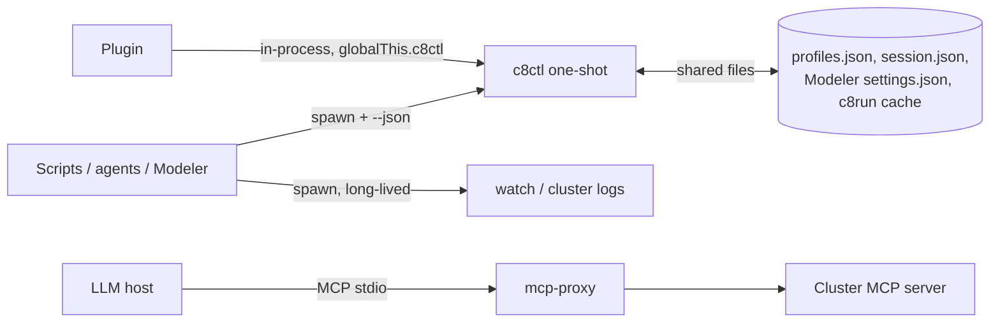
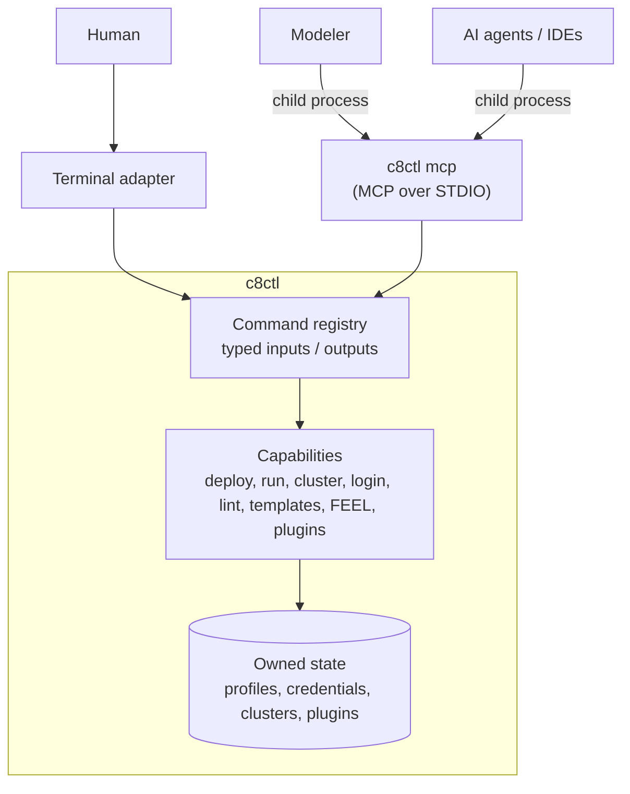
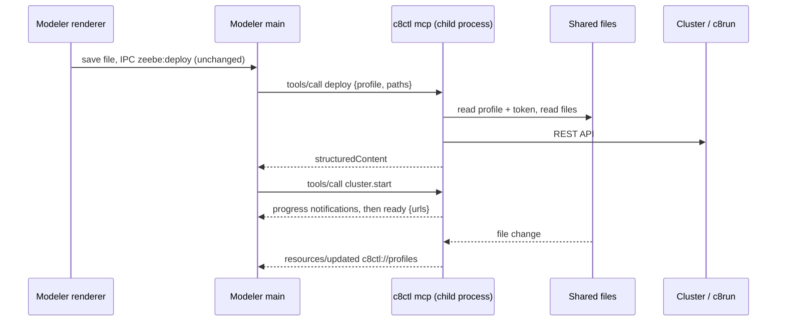

# Embedding c8ctl

> __Preliminary spec.__ Captures direction and open decisions; not an implementation plan.

## Context

* `c8ctl` becomes the core of our local development flow. Essential capabilities - local cluster download + start (exists), hub login (not built yet), deploy, run, lint, element templates, FEEL - live in `c8ctl`.
* Local development tools (Desktop Modeler, VS Code, AI agents) shall __build on__ `c8ctl` capabilities - not rebuild them.
* This sketch answers: how can tools call `c8ctl` today, how could they embed it in the future, and what does that require from `c8ctl`.

## Status quo

### Tool calling capabilities

| Capability           | What exists                                                                                                                                                          |
| -------------------- | -------------------------------------------------------------------------------------------------------------------------------------------------------------------- |
| JSON output contract | `--json` > `C8CTL_OUTPUT_MODE` > `c8ctl output json` (persisted). Data on stdout, `{"status":...}` messages on stderr, exit code `0` / `1`.                          |
| Agent flags          | `--fields` (trim output keys), `--dry-run` (emit the would-be API request as JSON).                                                                                  |
| Self-description     | `c8ctl help` in JSON mode returns the full command tree, plugin commands included. `c8ctl doctor plugin --json`. `CONTEXT.md` ships with the npm package.            |
| MCP                  | `c8ctl mcp-proxy` bridges a local STDIO MCP client to the __cluster's__ MCP server, injecting Camunda auth. `c8ctl`'s own commands are __not__ exposed as MCP tools. |
| Plugins              | Add commands, run in-process, use `globalThis.c8ctl` (client, profile, logger, npm). Default plugins: `cluster`, `bpmn`, `element-template`, `feel`.                 |
| Cluster lifecycle    | `cluster` plugin installs, starts, stops, inspects c8run. Only `status` emits structured JSON; `start` reports progress as text.                                      |

### Embedding models



1. __One-shot subprocess + JSON__ - the primary contract today.
2. __Long-running subprocess__ - `watch`, `mcp-proxy`, `cluster logs`; stopped via SIGINT.
3. __MCP over STDIO__ - proxies the cluster's MCP server only.
4. __In-process plugin__ - extends `c8ctl` from the inside.
5. __Shared files__ - `c8ctl` reads Modeler connections (`modeler:` profiles), never writes them.
6. __Library import__ - not supported. `exports` only exposes `./runtime`; command handlers are internal.

### The "server" model today

There is no `c8ctl` server or daemon. Every invocation is a short-lived process. Server-like pieces:

* __`mcp-proxy`__ - a real long-running MCP server over STDIO, but stateless and tools-only, forwarding remote tools. It already has what a `c8ctl mcp` would reuse: MCP SDK, STDIO transport, auth injection (`createCamundaFetch`), graceful SIGINT shutdown.
* __`watch`__ - long-running, but output-only; nothing can send it requests.
* __`cluster`__ - daemon-less. The long-lived process is c8run itself; `c8ctl` reconstructs state per invocation from files (`cluster.pids` with start signatures, marker files, c8run pidfiles) plus a health poll on `:9600`.
* __Update check__ - detached, unref'd worker writing a cache file: background work without a daemon.
* __Files are the shared state__ - `profiles.json` (atomic writes), `session.json`, Modeler `settings.json` (read-only).

The established pattern: __state lives in files, processes come and go.__

## Problems

* __No programmatic contract__ beyond spawning a process per call. No schemas for inputs or outputs, no versioning.
* __Long-running operations are not machine-readable__ - `cluster start` has no structured progress or "ready" event.
* __Errors are sentences__ - `{"status":"error","message":"Failed to deploy: ..."}`. Consumers cannot act on them without parsing English (see [Errors](#errors)).
* __Unbounded results__ - `c8ctl` fetches all pages by default (`DEFAULT_MAX_ITEMS = 1_000_000`). Fine for `| jq`, wrong for a tool call (see [Pagination](#pagination)).
* __Shared mutable session state__ - `c8ctl use profile` rewrites `session.json`; terminal and embedders would steer each other.
* __Duplicated capabilities__ - Modeler re-implements cluster access in its main process (`app/lib/zeebe-api`, 18 `zeebe:*` IPC handlers: deploy, start instance, connection check, searches, FEEL evaluation, cluster variables) and owns its own connection store.

## Approach

`c8ctl` stops being "a CLI" and becomes __one set of local Camunda capabilities__ exposed through thin adapters. The terminal is one of them.



* __Modeler is a UI on top of `c8ctl` capabilities.__ Deploy, start instance, connections, local cluster, hub login, linting, element templates call into `c8ctl`. Modeler owns rendering and editing, not cluster or auth logic.
* __One owner of state.__ One login, one local cluster, one profile store - consistent across terminal, Modeler, VS Code and agents.
* __Plugins work everywhere.__ A `c8ctl` plugin automatically shows up in Modeler and for agents.
* __MCP is the embedding protocol.__ It already covers what an embedder needs - the same surface serves Modeler and AI agents:

| Embedder needs                                  | MCP feature                             |
| ----------------------------------------------- | --------------------------------------- |
| Call capabilities with typed inputs and outputs | Tools, JSON Schema, `structuredContent` |
| Progress (download, cluster start)              | Progress notifications                  |
| Cancel an operation                             | Cancellation                            |
| Ask the user (confirm, choose tenant, login)    | Elicitation                             |
| Observe state (profiles, cluster status)        | Resources + subscriptions               |

* __Keep the existing state model.__ The server is a connection adapter, not the owner of state. Files stay the source of truth; a crashing server loses nothing and the cluster keeps running.
* __Keep the core MCP-agnostic.__ Handlers do not know about MCP; switching to plain JSON-RPC stays cheap.

### Disk is the source of truth

* Embedders __save before calling `c8ctl`__ (e.g. Modeler saves before deploy). Tools take paths - files, folders, a `camunda.json` project root - never content. Matches `c8ctl deploy <paths>` today.
* __Explicitly no language-server duality.__ No in-memory overlays, no virtual file system, no `didChange` for in-flight edits. An unsaved diagram must be saved first.
* Editing-time features that operate on unsaved state (live linting, FEEL completion, properties panel) stay shared __libraries__ inside the editor - out of scope for `c8ctl`.

### Errors

MCP separates protocol errors (unknown tool, invalid params -> JSON-RPC error) from execution failures (`isError: true` result). A result carrying only text is not enough for an application.

__Modeler today__ consumes typed reasons. `zeebe-api.js` classifies failures (`getErrorReason`), `ConnectionCheckErrors.js` attaches them __to the right form field__:

| Reason                            | Modeler shows it                            |
| --------------------------------- | ------------------------------------------- |
| `INVALID_CREDENTIALS`             | at the client secret field                  |
| `INVALID_CLIENT_ID`               | at the client ID field                      |
| `OAUTH_URL`                       | at the OAuth URL field                      |
| `CLUSTER_TEMPORARILY_UNAVAILABLE` | "paused or starting up" + troubleshoot link |
| `CONTACT_POINT_UNAVAILABLE`       | at the endpoint field + troubleshoot link   |

Deploy failures keep engine `code` / `details` (`asSerializedError`), e.g. BPMN parse errors.

__Over MCP with today's `c8ctl`__ this becomes:

```json
{ "isError": true, "content": [{ "type": "text", "text": "Failed to check connection: invalid_client" }] }
```

Modeler would pattern-match English to highlight a field; rewording a message in `c8ctl` silently breaks the connection form.

__Required:__ a stable, versioned error code catalog, returned as data:

```json
{
  "isError": true,
  "structuredContent": {
    "code": "INVALID_CREDENTIALS",
    "field": "clientSecret",
    "problem": { "status": 401, "title": "..." },
    "hint": "..."
  },
  "content": [{ "type": "text", "text": "The client secret is not valid for the client ID provided." }]
}
```

* `problem` passes RFC 9457 details from the engine through unchanged.
* The same codes serve CLI `--json` and agents (e.g. an agent reacting to `UNAUTHORIZED` by suggesting `c8ctl login`).

### Pagination

Applies to __any__ agent - even more than to Modeler. A tool result is a single message.

__Example:__ asked "why does `order-process` keep failing?", an agent calls `search incidents --processDefinitionId=order-process`. On a busy cluster that is ~30,000 incidents, megabytes of JSON - exceeding the host's context limit, getting truncated silently, timing out, or making the agent reason over an arbitrary slice.

MCP has no pagination for tool results (cursors exist for `tools/list` etc. only). `c8ctl` provides it:

* __Inputs:__ `limit` (small default, e.g. `20`), `cursor` (Camunda `searchAfter`), `fields`.
* __Output:__ `page: { totalItems, endCursor, hasMore }`.
* `limit: 0` returns `totalItems` only - answers "how many?" cheaply.
* Variable values stay truncated by default (as `c8ctl` does today without `--fullValue`). Modeler task testing explicitly asks for full values (`truncateValues: false`).

### Audiences: apps vs. agents

Mostly __one capability, two projections__ - not two tool sets.

| Tool                                                     | Modeler                            | Agent                                            |
| -------------------------------------------------------- | ---------------------------------- | ------------------------------------------------ |
| `connection.check` with draft, unsaved credentials       | Needed (settings form)             | Must not handle raw secrets -> app only          |
| `profiles` resource (subscribable)                       | Drives the connection picker       | Not useful                                       |
| `engine.version`                                         | Gates features per engine version  | Rarely useful                                    |
| `cluster.start` with progress                            | Progress bar                       | Fine; only needs the final "ready + URLs"        |
| `profile.delete`, `cluster purge`, `cancel pi`           | Own confirmation dialog            | `destructiveHint` + confirmation via elicitation |
| `search pi`                                              | Full typed objects                 | Trimmed: `fields`, `limit`, truncated values     |
| Composite "explain incident" (incident + vars + element) | Not needed                         | Very useful                                      |

* Both projections derive from the command registry, with different defaults (limit, fields, truncation) and visible tool sets.
* __App-only__: tools taking secrets or managing UI state.
* Mechanisms: audience chosen at server start (`c8ctl mcp --client=modeler`), MCP tool annotations (`readOnlyHint`, `destructiveHint`).

## Modeler over MCP



* __Process model__ - Modeler main spawns a bundled `c8ctl mcp` child using Electron's Node (`ELECTRON_RUN_AS_NODE`; Modeler is on Electron 44, satisfying Node >= 22.18). One child per Modeler, LSP-style; files keep instances consistent.
* __Incremental migration__ - IPC handlers become thin forwards to `callTool`; the renderer does not change at first.
* __Mapping__ - deploy, start, search, evaluate -> tools. Connections -> `c8ctl://profiles` resource. Local cluster -> tools with progress + status resource. Hub login -> tool using elicitation (URL mode for the browser step).
* __Bonus__ - Modeler's AI features and external agents see the same tools, plugin commands included.

## Requirements for `c8ctl`

1. __Host-agnostic handlers__ (continues the `ctx` direction): `ctx.progress()` instead of `logger.info`, `ctx.prompt()` / `ctx.confirm()` answered by TTY or elicitation, `ctx.signal` for cancellation, no global state reads.
2. __Schemas from the registry__ - flags + positionals -> input JSON Schema; `CommandResult` gets typed output schemas, versioned as a public contract.
3. __Explicit context per call__ - profile and tenant passed on every request. `session.json` is a terminal convenience, never shared state that steers other clients.
4. __Error code catalog__ - see [Errors](#errors).
5. __Bounded results__ - see [Pagination](#pagination).
6. __Credential broker__ - hub login (browser / device flow), tokens in the OS keychain, refresh owned by `c8ctl`.
7. __Managed long-running resources__ - a cluster or watch is a handle with lifecycle, status, logs and events, outliving the client that started it.
8. __State change notifications__ - profile changed, cluster stopped, plugin installed. Main reason for a server mode over spawn-per-call.
9. __Profile ownership moves to `c8ctl`__ - Modeler connections migrate into `c8ctl` profiles, inverting today's read-only `modeler:` bridge.
10. __Distribution + compatibility__ - Modeler bundles a pinned `c8ctl`; protocol version handshake on connect.
11. __Local security__ - reachable by the current user only (STDIO child; no open port).

## Rollout

1. Refactor handlers to `ctx` progress, prompts and cancellation; derive schemas from the registry. Valuable on its own.
2. Ship `c8ctl mcp` exposing `c8ctl`'s own commands as tools (error codes, pagination, audiences). Immediate value for agents; validates the contract.
3. Credential broker + hub login, cluster handles, state notifications.
4. Migrate Modeler features one by one (local cluster and deploy first), then move connections into `c8ctl` profiles.

## Open questions

* __One shared server vs. one per client?__ Per client (LSP-style) is simpler and leans on files for consistency; shared allows in-memory state but needs discovery and lifecycle management.
* __MCP vs. custom JSON-RPC?__ MCP gives agents the same surface for free; resources + subscriptions may prove too thin for rich application state.
* __Library import__ in addition to the protocol, or the protocol as the only contract?
* __Relation to `mcp-proxy`__ - fold into `c8ctl mcp` (cluster tools re-exported next to `c8ctl` tools), or keep separate?
* __Hub login and Modeler__ - which Modeler connection types migrate as-is, which are superseded by hub login?

## Future extensions

* `c8ctl mcp install <client>` for one-step agent setup ([#293](https://github.com/camunda/c8ctl/issues/293)).
* Processes exposed as agent tools surfaced through `c8ctl mcp` ([#433](https://github.com/camunda/c8ctl/issues/433)).
* VS Code extension on top of `c8ctl mcp`.
